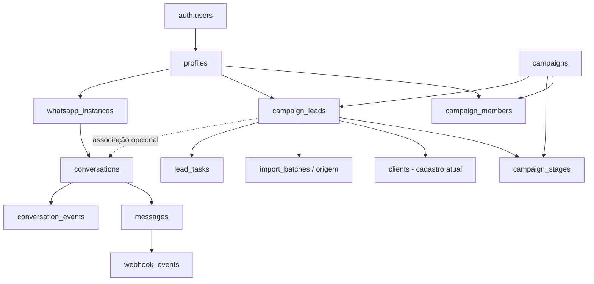

# Arquitetura de referência e modelo de dados — NÃO É migration pronta

Este documento orienta decisões **após a Fase 0**. Os nomes são **propostos**, não confirmação de que já existem. O desenvolvedor deve adaptar às colunas, triggers, constraints e policies reais.

## Princípio principal

**Uma organização/instância lógica NaveProspect**, no mesmo projeto Supabase informado; **um cadastro de contatos**, múltiplas **campanhas e participações independentes**, muitos **usuários**, muitas **instâncias WhatsApp**.

## Tabelas legadas relatadas

- `clients`: cadastro de clientes e campos atuais da campanha Upgrade; contém status, NPS, contatos, observações, datas e flags legadas.
- `interactions`: contatos, movimentações e histórico; preservar FKs e semântica atual.
- `audit_logs`: trilha atual; preservar, acrescentar referência ao ator/perfil quando viável sem quebra.

**Não mover os 125 clientes para tabela nova nem recriar `clients`.** O vínculo da participação em campanha deve apontar ao mesmo `clients.id`.

## Tabelas sugeridas por ordem

| Fase | Entidade | Chaves/regras importantes |
|---|---|---|
| 1 | `profiles` | `id` → `auth.users.id`, papel, ativo |
| 2 | `campaigns` | `id` UUID, nome, tipo, estado |
| 2 | `campaign_members` | `unique(campaign_id,user_id)`, papel/escopo |
| 2 | `campaign_stages` | `id`, `campaign_id`, ordem e tipo (`open/won/lost`) |
| 2 | `campaign_leads` | `id`, `campaign_id`, `client_id`, `stage_id`, `assigned_user_id`, `unique(campaign_id,client_id)` |
| 3 | `import_batches` | `id`, `campaign_id`, uploader, hash, totais, status |
| 3 | `import_batch_rows` ou `batch_occurrences` | repetição controlada por `(batch_id,row_number)`, resultado, vínculo |
| 4 | `lead_tasks` | `campaign_lead_id`, responsável, vencimento UTC, status |
| 5 | `whatsapp_instances` | nome externo único, owner, status, sem segredo público |
| 6 | `conversations` | instância + contato + vínculo de campanha opcional, estado |
| 6 | `messages` | origem/direção, IDs externos, conteúdo, status, autoria |
| 6 | `conversation_events` | append-only, responsável e evento |
| 6 | `webhook_events` | dedupe, processamento/erros/retry |
| 9 | `ai_usage_logs` (opcional) | custo, modelo, tokens, usuário, contexto com PII mínimo |

## Invariantes de dados

1. A entidade `clients` representa contato; `campaign_leads` representa oportunidade/participação. Status e `converted_at` de cada campanha pertencem ao vínculo, **não ao contato global**.
2. `campaign_stages.campaign_id` deve corresponder a `campaign_leads.campaign_id`; validar no serviço e preferencialmente no banco. Nunca aceitar ID de etapa de outra campanha.
3. A identidade por telefone é heurística: normalização não pode criar telefone inexistente. Contatos sem telefone válido podem exigir revisão manual.
4. O mesmo número em campanhas diferentes é permitido; não apagar ou mesclar históricos de forma automática.
5. Cada importação preserva sua própria procedência; aparecer novamente no lote não implica reabrir lead vendido ou sobrescrever responsável.
6. Conversas são identificadas no mínimo por instância e contraparte; campanha pode ser desconhecida e ir à triagem.
7. Webhooks têm processamento idempotente; usar identificador externo composto **que a Evolution realmente forneça**. Não declarar uma constraint única sem verificar o formato de eventos.
8. Mensagens e auditoria devem preservar autoria, timestamps e integridade; operações de editar/excluir são estritamente limitadas conforme política de retenção.
9. Timestamp armazenado em UTC, formatado em fuso `America/Bahia` na UI.
10. Consultas com chave privilegiada no backend precisam de autorização explícita mesmo quando RLS não for aplicado automaticamente à sessão de serviço.

## Estratégia de migração recomendada

1. Criar modelos aditivos e policies depois de validar esquema real.
2. Criar campanhas/etapas de Upgrade e vínculo dos registros existentes.
3. Conciliar `COUNT(DISTINCT client_id)` com contagem antiga, confrontar status e IDs.
4. Colocar novas telas para ler `campaign_leads` gradualmente sem quebrar telas legadas.
5. Testar triggers e atualizar lógica para impedir que conversões do Hotspot alterem campos legados de Upgrade.
6. Liberar apenas quando novo fluxo estiver demonstravelmente consistente; manter estratégia de desativação.

## Contratos de API propostos (não criar todos de uma vez)

- `GET /api/campaigns`, `POST /api/campaigns`, `GET /api/campaigns/:id/leads` — Fase 2.
- `POST /api/campaigns/:id/imports`, `GET /api/campaigns/:id/imports` — Fase 3.
- `POST /api/campaign-leads/:id/assign`, `POST /api/lead-tasks` — Fase 4.
- `POST /api/whatsapp/instances`, `POST /api/whatsapp/send` (com escolha de instância) — Fase 5.
- `POST /api/integrations/evolution/webhook`, `GET /api/conversations`, `GET /api/conversations/:id/messages` — Fase 6.
- `GET /api/reports/...`, `POST /api/reports/export` — Fase 7.
- `POST /api/ai/suggest-reply` — Fase 9.

**Rotas são exemplos de responsabilidade;** preservar o que já existir e adaptar contratos ao padrão real do repositório. Toda API deve exigir autenticação, autorização de escopo e validação de entrada.

## Regras transversais

- Índices em `campaign_id`, `assigned_user_id`, `stage_id`, `created_at`, `last_message_at` conforme queries reais; não criar índices sem medir custos.
- RBAC tanto em políticas RLS quanto em endpoints com credenciais privilegiadas.
- Integrações com observabilidade, timeout, retry idempotente, logs com PII reduzida.
- Backups, migrations versionadas, homologação e nenhuma mudança destrutiva em produção.
